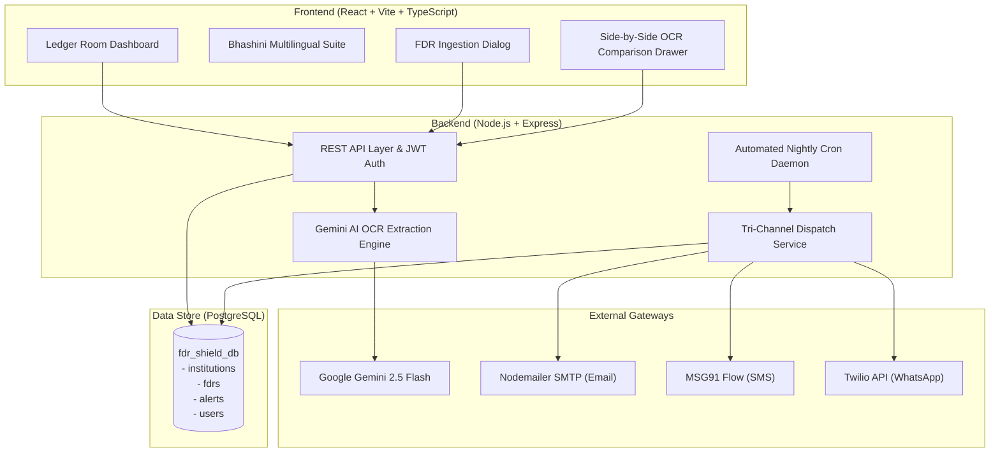

# AICTE FDR Shield 🛡️
> **Automated Security Deposit & Fixed Deposit Receipt (FDR) Monitoring Platform**  
> *Developed for Smart India Hackathon (SIH) 2026 | Problem Statement ID: 26265 | Theme: Smart Automation*  
> *Team: Ctrl+Alt+Elite*

---

## 📌 Executive Summary

Every technical institution affiliated with the **All India Council for Technical Education (AICTE)** is mandated to maintain security deposits via Fixed Deposit Receipts (FDRs) under joint names with AICTE. Historically, managing thousands of paper and digital FDR certificates across hundreds of banks has suffered from:
1. **Manual Ingestion & Human Error:** Discrepancies between physical receipts and online claims.
2. **Lapsed Maturity & Revenue Leakage:** FDRs maturing unnoticed, resulting in lost auto-rollover interest or uncollected penalties.
3. **Communication Friction:** Over-reliance on postal mail or missed phone calls without delivery tracking.
4. **Lack of Regional Language Support:** College registrars across India face language barriers on central portals.

**AICTE FDR Shield** resolves these challenges with an end-to-end automated platform featuring **Multimodal Vision AI Document Verification**, a **human-in-the-loop verification desk**, **automated tri-channel regulatory escalation (Email, SMS, WhatsApp)**, and a **Digital India Bhashini-compliant multilingual suite**.

---

## 🌟 Key Modules & Innovations

### 1. 🤖 Multimodal Vision AI & Tamper Detection Engine
- When an institution uploads an FDR receipt (PDF/Image), an automated Vision-Language Model (VLM) pipeline extracts critical metadata:
  - FDR Certificate Number
  - Issuing Bank & Branch
  - Deposit Principal Amount
  - Issue Date & Scheduled Maturity Date
  - Joint Ownership Clause (`AICTE & Institution Name`)
- The system performs automated cross-field reconciliation against the institution's self-entered form data, flagging discrepancies (e.g. ₹20,00,000 entered vs ₹25,00,000 on receipt) with confidence scores.

### 2. ⚖️ Human-in-the-Loop Verification Queue
- AICTE desk officers review flagged discrepancies via an interactive side-by-side audit drawer.
- Officers can approve, reject, request clarification, or flag deposits for compliance action with an immutable audit log.

### 3. 🚨 Tri-Channel Automated Regulatory Escalation
- A scheduled cron daemon scans maturity dates nightly and triggers automated alerts:
  - **30 Days Remaining:** Initial renewal reminder.
  - **15 Days Remaining:** Urgent compliance notice.
  - **7 Days Remaining:** Critical regulatory alert with forfeiture warning.
  - **Overdue:** Automatic non-compliance flag.
- **Dispatch Channels:**
  - **Official AICTE HTML Email** via Nodemailer SMTP with national emblem styling and one-click portal login.
  - **Priority SMS** via MSG91 Flow API.
  - **Verified WhatsApp Business Notice** via Twilio.

### 4. 🌐 Digital India Bhashini Multilingual Suite
- Integrated multilingual support for **7 Indian Scheduled Languages**:
  - English (`en`)
  - हिन्दी (Hindi - `hi`)
  - मराठी (Marathi - `mr`)
  - தமிழ் (Tamil - `ta`)
  - తెలుగు (Telugu - `te`)
  - ગુજરાતી (Gujarati - `gu`)
  - বাংলা (Bengali - `bn`)
- Instant client-side switching with persistent language preference.

### 5. 📊 Executive Portfolio Intelligence
- Single-pane-of-glass dashboard displaying:
  - Total security funds under guard (₹ Cr).
  - 30-day liquidity and maturity pipeline.
  - Issuing bank distribution (SBI, HDFC, PNB, Canara, ICICI).
  - Automated CSV register export for administrative reporting.

---

## 🏗️ Technical Architecture



---

## 💻 Tech Stack

| Layer | Technologies |
| :--- | :--- |
| **Frontend** | React 18, Vite, TypeScript, Tailwind CSS, Lucide Icons, Wouter, Sonner |
| **Backend** | Node.js, Express.js, JSON Web Tokens (JWT), Multer, Dotenv |
| **Database** | PostgreSQL (`pg`), relational schema with indexed maturity dates |
| **AI / OCR** | Multimodal Vision-Language Model (VLM / Gemini SDK) & Intelligent Document Processing |
| **Communication** | Nodemailer (SMTP), MSG91 Flow API (SMS), Twilio Client (WhatsApp) |
| **Internationalization** | Custom Bhashini i18n Context supporting 7 Indian languages |

---

## 🚀 Quickstart & Local Setup

### Prerequisites
- Node.js (v18 or higher)
- PostgreSQL (v14 or higher) running locally or in cloud
- Google Gemini API Key

### 1. Clone the Repository
```bash
git clone https://github.com/Code-Breaker-Ctrl/fdr-shield.git
cd fdr-shield
```

### 2. Configure Backend & Database
```bash
cd fdr-shield-backend
npm install

# Configure environment variables
cp .env.example .env
# Edit .env with your PostgreSQL credentials & GEMINI_API_KEY

# Initialize database schema and seed data
psql -U postgres -d fdr_shield_db -f database.sql

# Start backend server (runs on port 5000)
npm run dev
```

### 3. Configure Frontend
```bash
cd ../fdr-shield-frontend
npm install

# Start frontend dev server (runs on port 3000)
npm run dev
```

Visit **`http://localhost:3000`** in your browser.

---

## 📡 API Reference

| Endpoint | Method | Role | Description |
| :--- | :--- | :--- | :--- |
| `/api/auth/login` | POST | Public | Authenticates user and returns signed JWT token |
| `/api/fdrs` | GET | Public/Auth | Fetches active portfolio FDR records with pagination and filters |
| `/api/fdrs` | POST | College/Officer | Submits a new FDR with receipt attachment & Gemini OCR trigger |
| `/api/fdrs/:id/decision` | PATCH | Officer | Records verification audit decision (Approve/Reject/Flag) |
| `/api/institutions` | GET | Auth | Lists registered AICTE-affiliated institutions |
| `/api/alerts/cron` | POST | Admin/System | Manually triggers the automated maturity alert scan |

---

## 👥 Team Flux (SIH 2026)
- **Problem Statement ID:** 26265
- **Category:** Software
- **Theme:** Smart Automation

---

*© 2026 AICTE FDR Shield. Built with pride for Smart India Hackathon 2026.*
