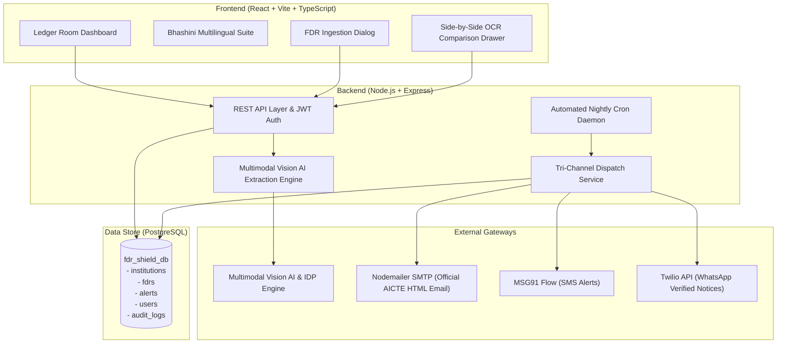

# AICTE FDR Shield 🛡️
> **Automated Security Deposit & Fixed Deposit Receipt (FDR) Monitoring Platform**  
> *Developed for Smart India Hackathon (SIH) 2026 | Problem Statement ID: 26265 | Theme: Smart Automation*  
> **Team Name:** FLUXDCE | **Team ID:** 199409 | **Category:** Software | **Institution:** Dronacharya College of Engineering (DCE)

[](https://youtu.be/_q_NSYcsIc8?si=9OHKo1z36eukq9Sj)
[](https://github.com/Code-Breaker-Ctrl/fdr-shield)
[](https://sih.gov.in)

---

## 📌 Executive Summary

Every technical institution affiliated with the **All India Council for Technical Education (AICTE)** is mandated to maintain security deposits via Fixed Deposit Receipts (FDRs) lodged under joint names with AICTE. Historically, managing thousands of paper and digital FDR certificates across hundreds of scheduled commercial banks has suffered from:
1. **Manual Ingestion & Human Error:** Discrepancies between physical deposit slips and online regulatory entries.
2. **Missed Maturity Dates & Revenue Leakage:** FDRs maturing unnoticed, leading to delayed renewals, uncollected penalties, or compliance lapses.
3. **Communication Friction:** Over-reliance on postal mail or missed phone calls without verified delivery tracking.
4. **Lack of Regional Language Support:** College registrars across India face language barriers on central English-only portals.

**AICTE FDR Shield** resolves these challenges with an end-to-end automated platform featuring **Multimodal Vision AI Document Verification**, a **human-in-the-loop verification queue**, **automated tri-channel regulatory escalation (Email, SMS, WhatsApp)**, and a **Digital India Bhashini-compliant multilingual suite**.

---

## 🌟 Key Modules & Innovations

### 1. 🤖 Multimodal Vision AI & Document Verification
- When an institution uploads an FDR receipt (PDF or Image), an intelligent document processing (IDP) Vision model extracts critical metadata:
  - FDR Certificate Number
  - Issuing Bank & Branch
  - Deposit Principal Amount
  - Issue Date & Scheduled Maturity Date
  - Joint Ownership Clause (`AICTE & Institution Name`)
- Performs automated cross-field reconciliation against self-entered data, highlighting field-by-field discrepancies with confidence scores.
- *Regulatory note: AI extraction flags mismatched fields for officer review; final regulatory approval remains strictly with authorized administrators.*

### 2. ⚖️ Human-in-the-Loop Verification Queue & Audit Drawer
- AICTE desk scrutiny officers review flagged submissions via an interactive side-by-side reconciliation drawer.
- Officers can approve, reject, or request clarification, with every administrative decision appended to an immutable, timestamped audit trail.

### 3. 🚨 Tri-Channel Automated Regulatory Escalation Engine
- A scheduled cron daemon scans maturity dates nightly and triggers automated alerts:
  - **30 Days Remaining:** Initial renewal reminder.
  - **15 Days Remaining:** Urgent compliance notice.
  - **7 Days Remaining:** Critical regulatory alert with forfeiture warning.
  - **Overdue:** Automatic non-compliance flag.
- **Dispatch Gateways:**
  - **Official AICTE HTML Email** via Nodemailer SMTP with national emblem styling and direct portal login buttons.
  - **Priority SMS** via MSG91 Flow Gateway.
  - **Verified WhatsApp Business Notice** via Twilio with instant submission links.

### 4. 🌐 Digital India Bhashini Multilingual Suite
- Integrated multilingual support for **7 Scheduled Indian Languages**:
  - English (`en`)
  - हिन्दी (Hindi - `hi`)
  - मराठी (Marathi - `mr`)
  - தமிழ் (Tamil - `ta`)
  - తెలుగు (Telugu - `te`)
  - ગુજરાતી (Gujarati - `gu`)
  - বাংলা (Bengali - `bn`)
- Instant client-side switching with persistent language preference across all 7 workspace tabs.

### 5. 📊 Executive Portfolio Intelligence & Reports
- Single-pane-of-glass dashboard displaying:
  - Total security funds under guard (₹ Cr).
  - 30-day liquidity and upcoming maturity timeline.
  - Issuing bank distribution (SBI, HDFC, PNB, Canara, Axis, etc.).
  - Filtered administrative CSV report export for official record-keeping.

---

## 📊 Comparative Analysis

| Key Feature | AICTE Approval Portal | SBI YONO FD | HDFC NetBanking | FDR SHIELD (Team FLUX) |
| :--- | :---: | :---: | :---: | :---: |
| **Online FDR-Related Services** | ✅ | ✅ | ✅ | **✅** |
| **Maturity Date Visibility** | ❌ | ✅ | ✅ | **✅** |
| **AI/OCR Document Extraction** | ❌ | ❌ | ❌ | **✅** |
| **Automatic Discrepancy Detection** | ❌ | ❌ | ❌ | **✅** |
| **Configurable Regulatory Maturity Alerts** | ❌ | ❌ | ❌ | **✅** |
| **Institution-Wise Risk Dashboard** | ❌ | ❌ | ❌ | **✅** |
| **Multi-Channel Dispatch (Email/SMS/WhatsApp)** | ❌ | ❌ | ❌ | **✅** |
| **Timestamped Multi-Level Approval Trail** | ❌ | ❌ | ❌ | **✅** |
| **Bhashini 7-Language Indian Localization** | ❌ | ❌ | ❌ | **✅** |

---

## 🏗️ Technical Architecture



---

## 💻 Tech Stack

| Layer | Technologies |
| :--- | :--- |
| **Frontend** | React 18, Vite, TypeScript, Tailwind CSS, Lucide Icons, Wouter, Sonner |
| **Backend** | Node.js, Express.js, JSON Web Tokens (JWT), Multer, Dotenv |
| **Database** | PostgreSQL (`pg`), relational schema with indexed maturity dates |
| **AI / OCR** | Multimodal Vision AI & Intelligent Document Processing (IDP) |
| **Communication** | Nodemailer (SMTP), MSG91 Flow API (SMS), Twilio Client (WhatsApp) |
| **Internationalization** | Custom Bhashini i18n Context supporting 7 Indian languages |
| **Task Automation** | `node-cron` nightly automated maturity and alert daemon |

---

## 🚀 Quickstart & Single-Click Launch

### Option A: Windows Single-Click Launch (Easiest)
Simply double-click **`start.bat`** in the repository root. It will:
1. Start the Express Backend API on `http://localhost:5000`
2. Start the Vite React Frontend on `http://localhost:3000`
3. Automatically open `http://localhost:3000` in your default browser

To stop services anytime, double-click **`stop.bat`**.

---

### Option B: Manual Setup

#### 1. Clone the Repository
```bash
git clone https://github.com/Code-Breaker-Ctrl/fdr-shield.git
cd fdr-shield
```

#### 2. Configure Backend & Database
```bash
cd fdr-shield-backend
npm install

# Configure environment variables
cp .env.example .env
# Edit .env with your PostgreSQL credentials & API keys

# Initialize database schema and seed data
psql -U postgres -d fdr_shield_db -f database.sql

# Start backend server (runs on port 5000)
npm run dev
```

#### 3. Configure Frontend
```bash
cd ../fdr-shield-frontend
npm install

# Start frontend dev server (runs on port 3000)
npm run dev
```

Visit **`http://localhost:3000`** in your browser.

---

## 📡 API Reference

| Endpoint | Method | Role | Description |
| :--- | :--- | :--- | :--- |
| `/api/auth/login` | POST | Public | Authenticates user and returns signed JWT token |
| `/api/fdrs` | GET | Public/Auth | Fetches active portfolio FDR records with pagination and filters |
| `/api/fdrs` | POST | College/Officer | Submits a new FDR with receipt attachment & automated OCR trigger |
| `/api/fdrs/:id/decision` | PATCH | Officer | Records verification audit decision (Approve/Reject/Flag) |
| `/api/institutions` | GET | Auth | Lists registered AICTE-affiliated institutions |
| `/api/alerts/cron` | POST | Admin/System | Manually triggers the automated maturity alert scan |

---

## 👥 Team FLUXDCE (SIH 2026)

* **Team Name:** FLUXDCE
* **Team ID:** 199409
* **Problem Statement ID:** 26265
* **Problem Statement Title:** Streamline of security deposit/FDR Portal
* **Theme:** Smart Automation
* **Category:** Software
* **Institution:** Dronacharya College of Engineering (DCE)
* **Demo Video:** [Watch on YouTube](https://youtu.be/_q_NSYcsIc8?si=9OHKo1z36eukq9Sj)

---

*© 2026 AICTE FDR Shield. Built with pride for Smart India Hackathon 2026.*
